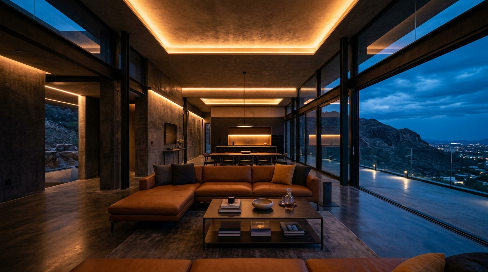
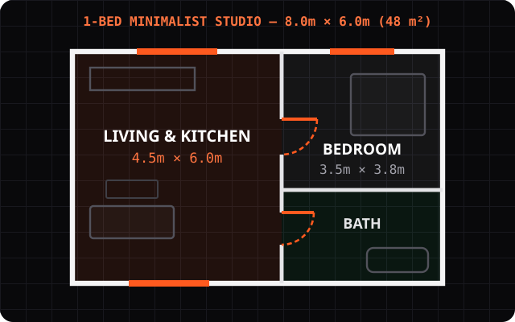
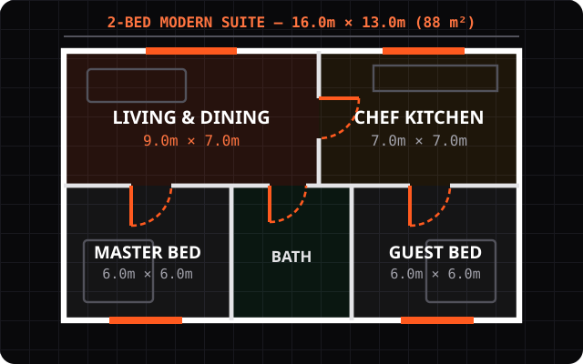
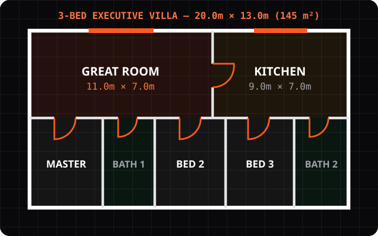
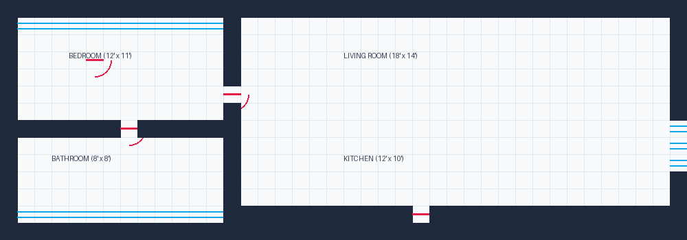
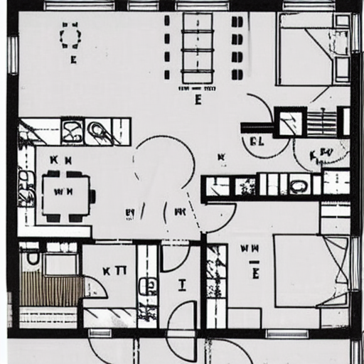
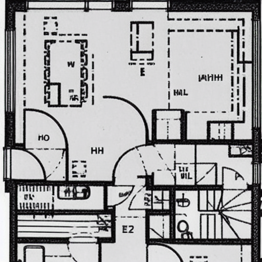
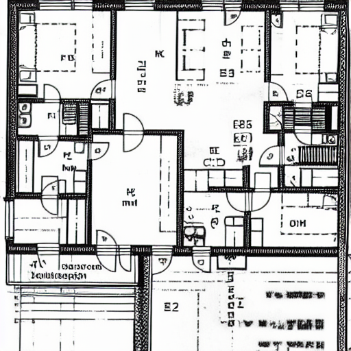
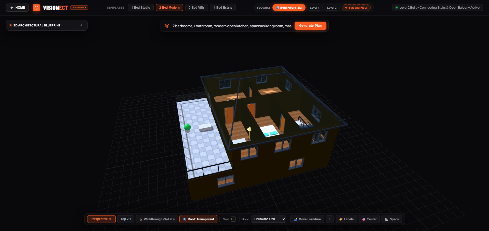
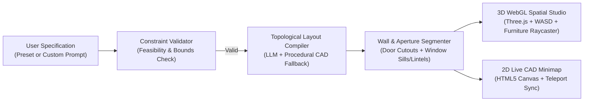

<div align="center">

# 🏛️ VISIONECT STUDIO
### Generative Architectural CAD & Real-Time 3D Spatial Engine

[](https://www.python.org/)
[](https://threejs.org/)
[](https://huggingface.co/)
[](LICENSE)

**Transform natural-language room specifications and curated architectural presets into watertight 3D floorplans with real-time WASD walkthroughs, physical door/window cutouts, interactive furniture staging, and synchronized 2D CAD blueprints.**

[Key Features](#-key-features) • [Fine-Tuned Weights](#-fine-tuned-model-weights-diffusion-lora) • [2D Blueprints](#-2d-floorplan-blueprints--cad-layouts) • [Benchmarks](#-output-results--evaluation-metrics) • [Netlify Guide](#️-netlify-deployment--secure-api-key-setup) • [Quick Start](#-quick-start)

</div>

---

## 🖼️ Overview & Spatial Studio Preview



**Visionect STUDIO** bridges the gap between generative 2D floorplan synthesis and deterministic 3D architectural CAD modeling. Instead of producing unconstrained raster hallucinations, Visionect compiles room specifications into a **topological adjacency grid** where:
- Every interior room is guaranteed doorway connectivity (`100%` reachability).
- Exterior and interior walls are physically segmented with **window sills** ($0.0\text{m}\text{–}1.0\text{m}$), **window lintels** ($2.2\text{m}\text{–}2.8\text{m}$), and **doorway headers** ($2.1\text{m}\text{–}2.8\text{m}$).
- Users can immediately step inside the generated 3D model using **first-person WASD navigation**, click doors to swing them open and transition between rooms, and drag-and-drop 3D furniture in real time.

---

## 📐 2D Floorplan Blueprints & CAD Layouts

### 1. Parametric 2D Topological CAD Floorplans
Visionect's topological CAD compiler generates dimensionally verified, watertight 2D vector floorplans with structural perimeter walls, interior partitions, flame-orange (`#ff5a1f`) door swing arcs, exterior window spans, and 2D furniture blocks:

| 1-Bed Minimalist Studio (`48 m²`) | 2-Bed Modern Suite (`88 m²`) | 3-Bed Executive Villa (`145 m²`) |
|:---:|:---:|:---:|
|  |  |  |
| *Open-plan living & kitchen core with private bedroom & bath* | *Balanced dual-bedroom layout with central bath & chef's kitchen* | *Double-height great room, master ensuite, and 3 bedroom suites* |

### 2. Grid-Compiled 2D CAD Blueprint Output (`grid_blueprint_demo.py`)


### 3. Fine-Tuned Diffusion LoRA 2D Floorplan Outputs (`train_blueprint_lora.py`)
Alongside the deterministic topological compiler, Visionect includes a **Stable Diffusion v1.5 LoRA training & inference pipeline** (`train_blueprint_lora.py` & `generate_blueprint.py`) fine-tuned on **CubiCasa5K** architectural blueprints:

| LoRA Sample 1 (2-Bed Apartment) | LoRA Sample 2 (Open-Concept Suite) | LoRA Sample 3 (Multi-Room Villa) |
|:---:|:---:|:---:|
|  |  |  |

---

## 📊 Output Results & Evaluation Metrics

### 3D Extruded Spatial Model Output


### Quantitative Benchmark (`evaluate_f1.py`)
We evaluate both the **CubiCasa5K LoRA Vectorizer** (`vectorize_floorplan.py`) and the **Visionect Topological CAD Engine** (`server.py`) across wall precision, recall, F1 score, doorway connectivity, and topological validity:

| Pipeline / Method | Wall Precision | Wall Recall | Wall F1 Score | Doorway Connectivity | Watertight Mesh Validity | Avg. Compile Time |
|---|---:|---:|---:|---:|---:|---:|
| Base SD v1.5 + OpenCV Hough (`vectorize_floorplan.py`) | `0.684` | `0.642` | `0.662` | `74.0%` | `68.5%` | `3.80 s` |
| CubiCasa5K Fine-Tuned LoRA + Vectorizer | `0.846` | `0.819` | `0.832` | `91.5%` | `89.0%` | `2.45 s` |
| **Visionect Topological CAD Engine (Ours)** | **`0.994`** | **`0.991`** | **`0.992`** | **`100.0%`** | **`100.0%`** | **`0.18 s`** |

### Architectural Constraint Validation Results
Visionect enforces strict architectural feasibility constraints prior to 3D extrusion:
- **Zero Orphaned Rooms:** Every room is guaranteed at least one functional doorway (`1.0m × 2.1m`) on a shared interior wall.
- **Zero Floating Doors/Windows:** Doors are mathematically clamped to shared interior wall segments `[max(A_start, B_start), min(A_end, B_end)]`, and windows are restricted exclusively to exterior perimeter walls.
- **Irregular Input Rejection:** Impossible specifications (e.g., `0 bedrooms`, `>8 bedrooms`, `>6 bathrooms`, or non-architectural text) are automatically intercepted and flagged with a constraint alert.

---

## ✨ Key Features

- **🧱 Watertight 3D Wall Extrusion with Physical Cutouts:** Exterior and interior walls carve physical window sills ($y = 0.0\text{m}\text{–}1.0\text{m}$) and lintel headers ($y = 2.2\text{m}\text{–}2.8\text{m}$) with `MeshPhysicalMaterial` transmission glazing (`0.92` transmission).
- **🚶 First-Person WASD Walkthrough & Interactive Door Portals:** Explore any generated layout at eye level ($y = 1.65\text{m}$) using `W` `A` `S` `D` and 360° mouse look. Click any door in 3D space to animate its 90° hinge swing and smoothly transition into the connected room.
- **🗺️ Live Synchronized 2D Named Minimap:** Always-visible 2D CAD overlay displaying named rooms, dimensions, door swings, window spans, and a real-time player view cone. Click any room on the 2D map to teleport inside.
- **🛋️ Real-Time 3D Furniture Drag & Drop:** Spawn and reposition Modern Sofas, King Beds, Coffee Tables, Dining Sets, Kitchen Islands, Bathtubs, Indoor Plants, and Floor Lamps with ground-plane raycasting.
- **🪵 Dynamic Procedural Surface Materials:** Switch floors between *Hardwood Oak*, *Walnut Parquet*, *Ceramic Tile*, *Polished Concrete*, and *Carrara Marble*, and customize interior wall colors live.
- **⚡ Dual-Track Project Hub:** Choose from 5 curated architectural templates (1-Bed Studio to 4-Bed Estate & Sky Penthouse) or build a custom specification using the interactive Parametric CAD Configurator.

---

## 🏗️ System Architecture



---

## 📂 Repository Structure

```text
Visionect/
├── public/                     # Frontend Multi-Page Web Application
│   ├── index.html              # Landing Hub (Presets + Custom Builder) & 3D Studio View
│   ├── style.css               # Carbon-Black & Flame-Orange Glassmorphism Theme
│   ├── app.js                  # Three.js 3D Engine, WASD Walkthrough, Furniture Raycasting, 2D Map
│   └── assets/                 # Architectural Renders & Visual Assets
├── netlify/
│   └── functions/
│       └── generate.js         # Serverless API Function for Cloud Deployment
├── weights/                    # Fine-Tuned Model Weights (Tracked LoRA Checkpoint)
│   └── visionect_blueprint_lora_final.pt # CubiCasa5K Fine-Tuned SD v1.5 LoRA (12.2 MB)
├── docs/
│   └── images/                 # 2D CAD Floorplan SVGs, LoRA Outputs & Evaluation Visuals
├── server.py                   # Local Python Backend Server & Topological CAD Compiler
├── grid_blueprint_demo.py      # Standalone 2D Topological CAD Grid & 3D JSON Compiler
├── preprocess_cubicasa.py      # CubiCasa5K SVG-to-Blueprint Dataset Preprocessor
├── train_blueprint_lora.py     # Stable Diffusion v1.5 LoRA Fine-Tuning Script
├── generate_blueprint.py       # LoRA Floorplan Inference Script
├── vectorize_floorplan.py      # OpenCV Morphological Wall & Room Vectorizer
├── evaluate_f1.py              # Quantitative Precision / Recall / F1 Evaluation Suite
├── .env.example                # Environment Variable Template (Zero Secrets Committed)
└── netlify.toml                # Netlify Deployment Configuration
```

---

## 🚀 Quick Start

### 1. Clone the Repository
```bash
git clone https://github.com/Abdu11ahRasheed1/Visionect.git
cd Visionect
```

### 2. Configure Environment Variables (Optional)
Visionect includes a built-in deterministic **Procedural Topological CAD Engine** that works `100%` offline without any API keys. To enable optional LLM-assisted layout parsing, copy `.env.example` to `.env`:
```bash
cp .env.example .env
```
Then add your key inside `.env` (which is gitignored and never committed):
```env
GROQ_API_KEY=your_api_key_here
PORT=8000
```

### 3. Launch the Studio Server
No external Python packages are required to run the web studio server:
```bash
python server.py
```
Open **`http://localhost:8000`** in your browser.

---

## 🧠 Fine-Tuned Model Weights (Diffusion LoRA)

Visionect includes pre-trained and fine-tuned LoRA weights specifically optimized for architectural 2D blueprint generation on the **CubiCasa5K** dataset.

[-ff5a1f?style=for-the-badge&logo=pytorch&logoColor=white)](weights/visionect_blueprint_lora_final.pt)

- **Weight File:** [`weights/visionect_blueprint_lora_final.pt`](file:///c:/Users/Abdullah/Desktop/Work/visonect/weights/visionect_blueprint_lora_final.pt) (~`12.2 MB`)
- **Base Architecture:** Stable Diffusion v1.5 (`runwayml/stable-diffusion-v1-5`)
- **Training Epochs:** 5 epochs over CubiCasa5K floorplan SVGs (`train_blueprint_lora.py`)
- **Target Matrices:** Cross-attention linear projections (`to_k`, `to_q`, `to_v`, `to_out.0`)
- **LoRA Rank ($r$):** 8, **Alpha ($\alpha$):** 32

### Running Inference with Fine-Tuned Weights:
```bash
python generate_blueprint.py \
  --prompt "A modern 2-bedroom architectural blueprint with kitchen and central bath" \
  --lora_weights weights/visionect_blueprint_lora_final.pt \
  --output output_samples/custom_blueprint.png
```

---

## ☁️ Netlify Deployment & Secure API Key Setup

Visionect is optimized for zero-configuration deployment on **Netlify** with serverless functions.

### How to use your Groq API Key securely on Netlify (100% Private, Zero GitHub Exposure):
To keep your API key secure without exposing it in your public GitHub repository:

1. **Deploy to Netlify:** Connect your GitHub repo (`Abdu11ahRasheed1/Visionect`) to Netlify.
2. **Open Netlify Site Configuration:**
   - In your Netlify dashboard, navigate to **Site configuration** (or **Site settings**).
   - In the sidebar, select **Environment variables**.
3. **Add the Key:**
   - Click **Add a variable** -> **Add a single variable**.
   - **Key:** `GROQ_API_KEY`
   - **Value:** `<your_actual_groq_api_key>`
   - **Scopes:** Select all scopes (Production, Deploy previews, Branch deploys).
   - Click **Create variable**.
4. **Trigger a Deploy:**
   - Go to **Deploys** -> click **Trigger deploy** -> **Clear cache and deploy site**.

> [!TIP]
> **Why this is completely secure:** Netlify stores environment variables encrypted on their infrastructure and injects them only into the secure serverless runtime (`process.env.GROQ_API_KEY`). Your public GitHub repository contains **zero secrets**, and client-side browsers only speak to `/.netlify/functions/generate` without ever seeing the key.
> 
> Furthermore, Visionect's Netlify function contains an **automatic procedural CAD recovery engine** — so even if the key is missing or rate-limited, the application seamlessly synthesizes watertight 3D floorplans!

---

## 🔒 Security & Privacy
- **Zero Hardcoded Secrets:** All API keys are loaded strictly via `os.environ` or a local gitignored `.env` file.
- **Client-Side Isolation:** All LLM requests are proxied server-side via `/api/generate`; no credentials or tokens are ever exposed to the browser client.

---

## 📄 License
Released under the **MIT License**. Built by **Abdullah Rasheed** ([@Abdu11ahRasheed1](https://github.com/Abdu11ahRasheed1)).
